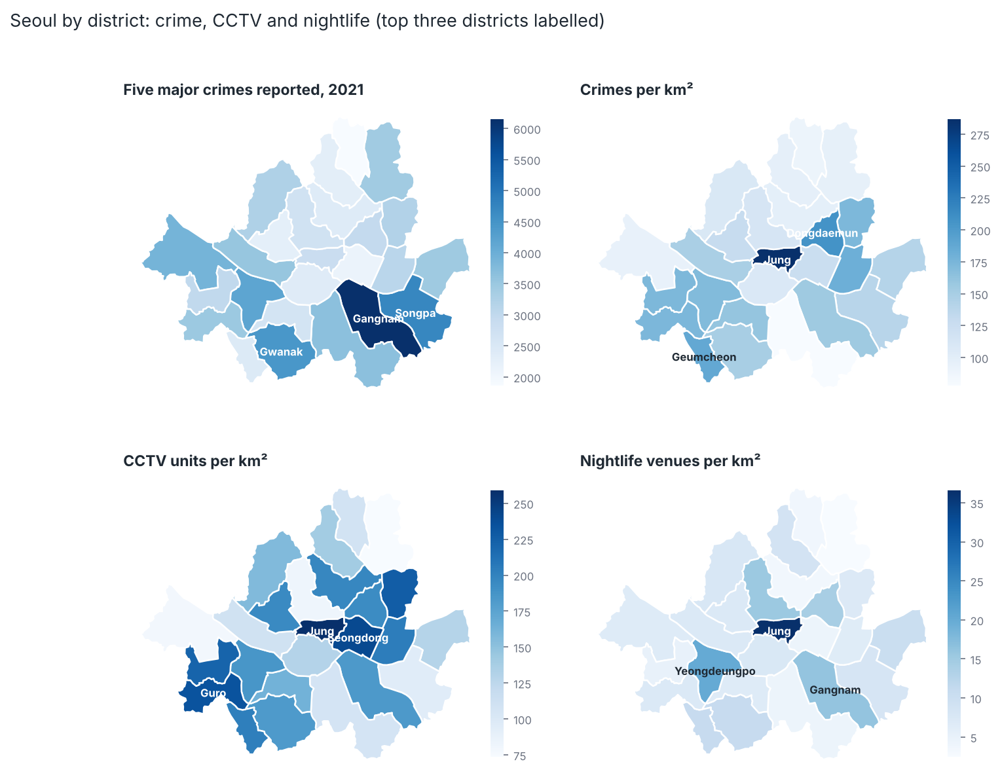
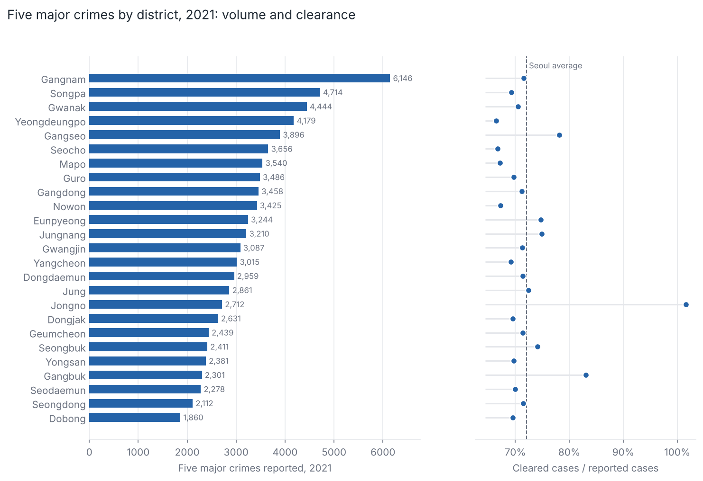
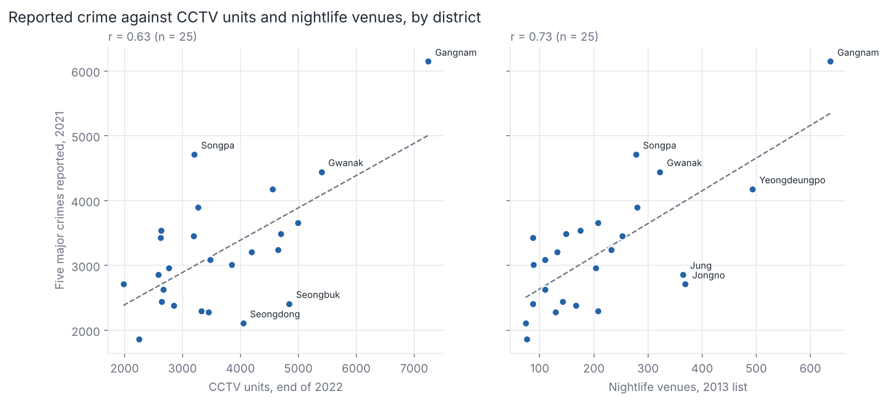

# seoul_crime_map

District-level look at reported crime in Seoul next to two things often linked to it:
CCTV coverage and nightlife venues. The repository turns six public tables into one tidy
table for the 25 autonomous districts, a set of static figures, and an interactive map.



## Questions

1. Where is reported crime concentrated, in counts and per km²?
2. Do districts with more CCTV units or more nightlife venues report more crime?
3. Does CCTV coverage go with a higher clearance rate?

## Pipeline

```bash
pip install -r requirements.txt
make all      # prepare.py -> analyze.py -> make_map.py
make test     # 5 checks of the tidy table against the source totals
```

| Step | Script | Output |
|---|---|---|
| Clean and join | `src/prepare.py` | `data/processed/district.csv` (25 rows, 35 columns) |
| Statistics and figures | `src/analyze.py` | `results/correlations.csv`, `figures/*.png` |
| Interactive map | `src/make_map.py` | `docs/index.html` (Leaflet, five switchable layers, hover tooltips) |

To publish the interactive map, enable GitHub Pages on the `/docs` folder.

## Findings

Seoul recorded 80,445 cases of the five major crimes in 2021 (theft 33,531, violence 41,757,
rape and indecent assault 4,911, murder 124, robbery 122), and 72% as many cases were cleared.

**Counts and density tell different stories.** Gangnam-gu has the most cases (6,146) and
Dobong-gu the fewest (1,860). Per km², the small central district Jung-gu leads by a wide
margin (287 cases per km²), ahead of Dongdaemun-gu (207) and Geumcheon-gu (187).



**Nightlife tracks crime more closely than CCTV does.** Across the 25 districts:

| Pair | Pearson r | Spearman rho |
|---|---|---|
| Nightlife venues and crimes reported | 0.73 | 0.62 |
| CCTV units and crimes reported | 0.63 | 0.40 |
| Nightlife venues per km² and crimes per km² | 0.72 | 0.49 |
| CCTV units per km² and crimes per km² | 0.69 | 0.71 |
| CCTV units and clearance rate | -0.23 | 0.03 |

Holding the other factor constant, the partial correlation with crime is 0.66 for nightlife
venues and 0.50 for CCTV units. The positive CCTV link is the expected pattern when cameras
are installed where crime is already high, so it says nothing about whether cameras deter crime.
CCTV count shows no relationship with the clearance rate.



Gangnam-gu is an outlier on every count measure, which pulls the Pearson values up.
The Spearman column is the safer reading.

## Data

| File (`data/raw/`) | Content | Period | Source |
|---|---|---|---|
| `Seoul_crime.xlsx` | Five major crimes, reported and cleared, by district | 2021 | Seoul Metropolitan Government, Seoul Basic Statistics (DT_201004_L030001) |
| `CCTV_years.csv` | CCTV units installed per district and year, 91,341 in total | to 31 Dec 2022 | Seoul Metropolitan Government |
| `CCTV_years_raw_221231.csv` | Raw export of the table above | same | same |
| `Seoul_night.xlsx` | 3,043 karaoke bars (단란주점) and 2,329 hostess bars (유흥주점) with district and address | 31 Aug 2013 | Seoul Metropolitan Government |
| `CCTV_pt.xlsx` | CCTV counts per administrative dong with area; used here for district area | derived | derived from `CCTV_Info.xlsx` |
| `CCTV_Info.xlsx` | 46,398 CCTV site records with coordinates and purpose | to 2023 | public CCTV data; kept for reference, unused in the pipeline |
| `Seoul_house.xlsx` | Officetel rent by region | Feb to Jun 2020 | Korea Real Estate Board (DT_08002_06); unused, see limitations |

District boundaries (`data/geo/seoul_municipalities.json`): Statistics Korea 2013 boundaries,
simplified, from the `southkorea/seoul-maps` repository.

## Limitations

- 25 districts is a small sample, and all results are cross-sectional correlations.
- The tables come from different years: nightlife 2013, crime 2021, CCTV 2022.
- Crime is not normalised by population. Resident population understates exposure in commercial districts such as Jung-gu and Jongno-gu, and no population table is in the data. Area is used as the denominator.
- Jongno-gu shows a clearance rate above 100%, which can happen when cases reported in earlier years are cleared in 2021.
- One karaoke-bar record has an empty district cell and is assigned to the district of the neighbouring rows (Gangbuk-gu).
- The rent table reports five Seoul zones and has no district breakdown, so it is left out of the analysis.
- The geometry column of `CCTV_pt.xlsx` is cut off by Excel's cell limit; the boundary file above is used for maps.

## History

The data were collected in 2023 for a course project. The pipeline, figures and map in this
repository were rebuilt from those files in November 2026.
